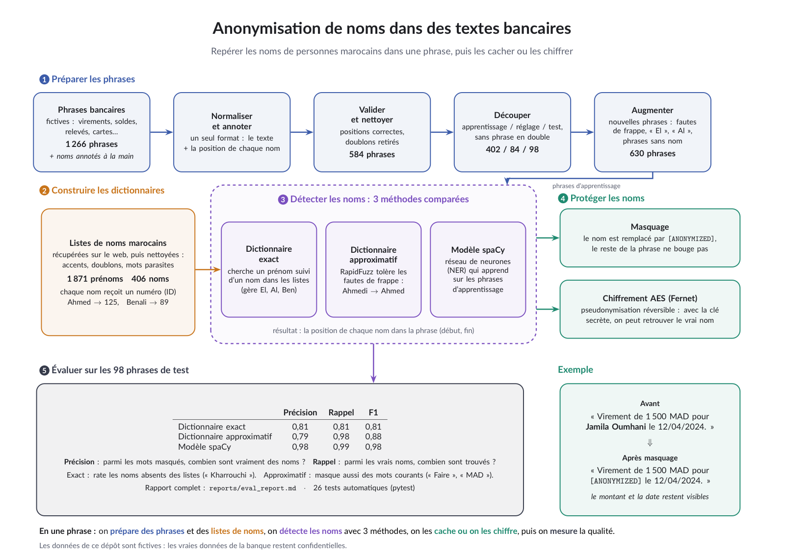

# Anonymisation de noms dans des textes bancaires

Projet de NLP réalisé pendant un stage de Data Scientist dans une banque marocaine (2025).

**Objectif :** repérer automatiquement les **noms de personnes marocains** dans des textes bancaires
(virements, relevés, demandes clients…) puis les **cacher** ou les **chiffrer**, pour protéger les
données personnelles des clients (RGPD).

```
Avant              : Virement de 1500 MAD pour Jamila Oumhani le 12/04/2024.
Après (spaCy)      : Virement de 1500 MAD pour [ANONYMIZED] le 12/04/2024.
Après (dictionnaire): Virement de 1500 [ANONYMIZED] pour [ANONYMIZED] Oumhani le 12/04/2024.
```

Le dictionnaire montre bien ses limites sur cet exemple : « Oumhani » n'est pas dans la liste des noms,
et « MAD » ressemble à un nom de la liste.



> Les données de ce dépôt sont **fictives** (phrases générées, noms marocains courants).
> Les vraies données de la banque sont confidentielles et ne sont pas publiées.

## Comment ça marche

### 1. Les dictionnaires de noms
Des listes de prénoms et de noms marocains ont été récupérées sur le web puis nettoyées
(accents, doublons, mots parasites) : **1 871 prénoms** et **406 noms de famille**.
Chaque nom reçoit un identifiant (`src/build_dict.py`).

### 2. La préparation des phrases
Le script `scripts/run_data_pipeline.py` enchaîne :
1. **Normaliser** toutes les sources dans un seul format (le texte + la position de chaque nom).
2. **Annoter** les noms à partir d'une liste écrite à la main (`data/annotations/noms_annotes.txt`).
3. **Valider et nettoyer** : positions correctes, doublons retirés (1 266 → 584 phrases).
4. **Découper** en apprentissage / réglage / test (402 / 84 / 98), sans qu'une même phrase soit dans deux jeux.
5. **Augmenter** le jeu d'apprentissage : fautes de frappe, particules « El »/« Al », phrases sans nom (630 phrases).

### 3. La détection : 3 méthodes comparées
| Méthode | Principe |
|---|---|
| **Dictionnaire exact** | cherche un prénom suivi d'un nom dans les listes (gère « El », « Al », « Ben ») |
| **Dictionnaire approximatif** | même chose, mais tolère les fautes de frappe grâce à RapidFuzz (« Ahmedi » → « Ahmed ») |
| **Modèle spaCy (NER)** | un modèle de reconnaissance d'entités entraîné sur les phrases d'apprentissage |

### 4. La protection
- **Masquage** (`src/anonymization/mask.py`) : le nom est remplacé par `[ANONYMIZED]`, le reste de la phrase ne bouge pas.
- **Chiffrement AES avec Fernet** (`src/aes_fernet.py`) : pseudonymisation réversible. Avec la clé secrète, on peut retrouver le vrai nom.

## Résultats

Sur les 98 phrases de test :

| Méthode | Précision | Rappel | F1 |
|---|---:|---:|---:|
| Dictionnaire exact | 0.81 | 0.81 | 0.81 |
| Dictionnaire approximatif (seuil 80) | 0.79 | 0.98 | 0.88 |
| spaCy NER | 0.98 | 0.99 | 0.98 |

- **Précision** : parmi les mots détectés, combien sont vraiment des noms ?
- **Rappel** : parmi les vrais noms, combien sont trouvés ?

**Analyse des erreurs :**
- Le **dictionnaire exact** rate les noms de famille absents des listes (« Kharrouchi », « Oumhani ») : seul le prénom est alors masqué.
- Le **dictionnaire approximatif** retrouve presque tous les noms, mais masque aussi des mots courants (« Faire », « au », « MAD »).
- **spaCy** obtient le meilleur score, mais il est entraîné et testé sur des phrases synthétiques qui se ressemblent beaucoup : sur de vrais textes, plus variés, le score serait plus bas.

Le rapport complet est généré dans [`reports/eval_report.md`](reports/eval_report.md).

## Structure du projet

```
data/
  raw/                  phrases fictives et listes de noms marocains
  annotations/          liste des noms annotés à la main
  processed/            données préparées (v1 nettoyée, v2 augmentée)
  splits/               découpage apprentissage / réglage / test
docs/                   schéma du projet
reports/                rapports de données et d'évaluation
results/                dictionnaires de noms (format JSON)
scripts/
  run_data_pipeline.py  préparation des données
  run_train.py          entraînement du modèle spaCy
  run_eval.py           évaluation des 3 méthodes
  run_end2end.py        anonymiser un fichier texte
src/
  data/                 normalisation, annotation, validation, découpage, augmentation
  detection/            détecteur par dictionnaire et détecteur spaCy
  anonymization/        masquage des noms
  evaluation/           calcul des scores
  build_dict.py         construction des dictionnaires
  detect_names.py       première version du détecteur
  aes_fernet.py         chiffrement des noms
tests/                  tests automatiques (pytest)
```

## Installation

```bash
python -m venv .venv
source .venv/bin/activate
pip install -r requirements.txt
```

## Utilisation

```bash
make data    # préparer les données
make train   # entraîner le modèle spaCy
make eval    # évaluer les 3 méthodes et générer le rapport
make test    # lancer les 26 tests
```

Anonymiser son propre fichier texte (après `make train`) :

```bash
python scripts/run_end2end.py --input mon_texte.txt --detector spacy
```

Le texte anonymisé est écrit dans `data/eval/end2end_anonymized.txt`.
Avec `--detector dict`, on utilise le dictionnaire à la place du modèle spaCy.

## Technologies

Python · spaCy · RapidFuzz · pandas · cryptography (Fernet / AES) · pytest

## Auteur

Adil Benjamaa — Master Informatique, Université de Bordeaux
